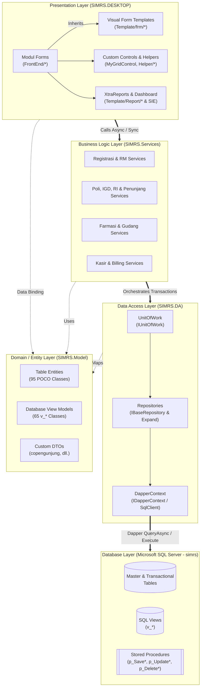
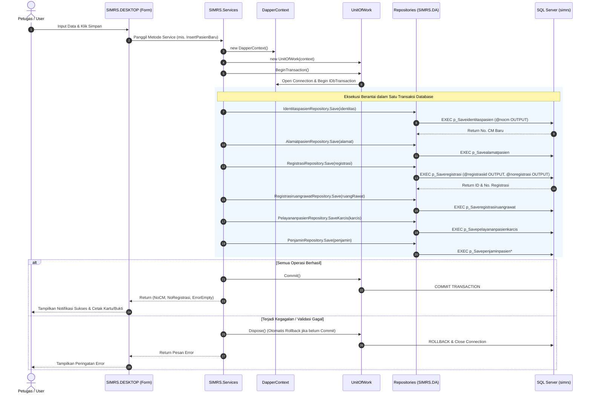
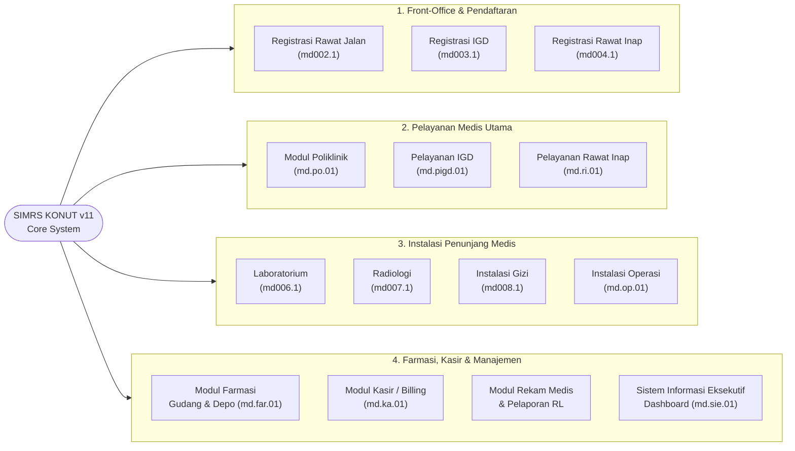
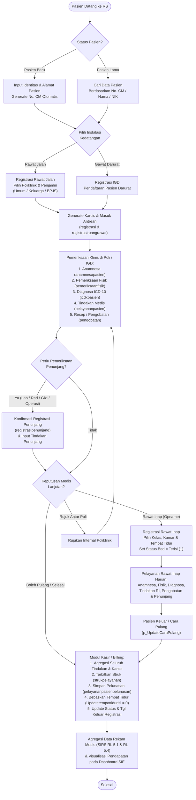
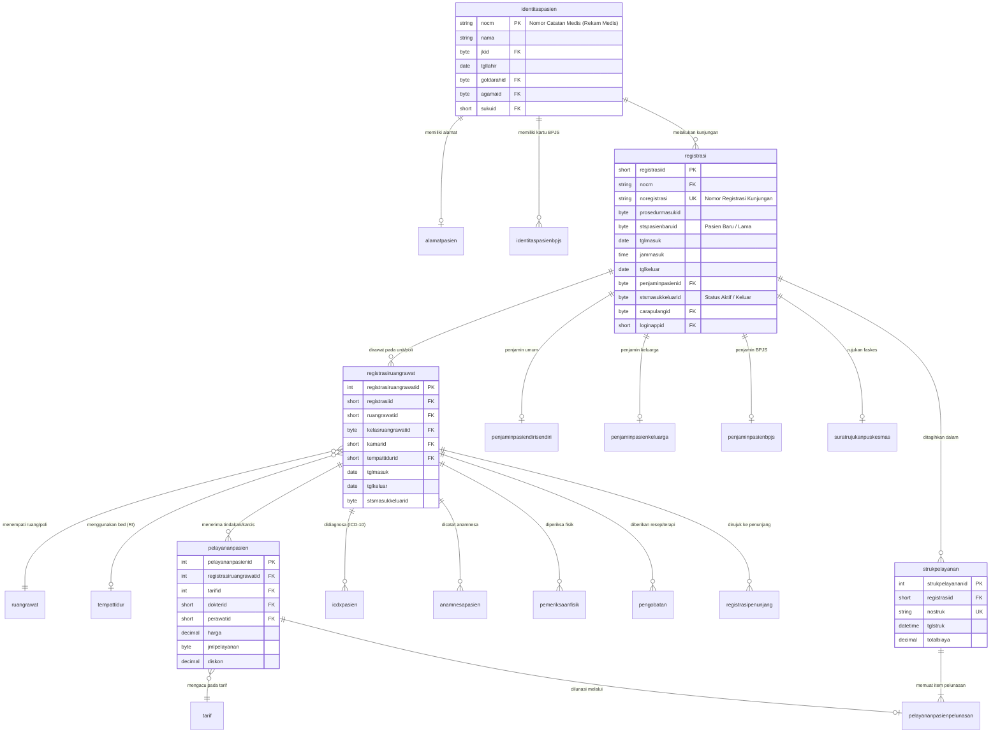

# SIMRS KONUT v11 — Sistem Informasi Manajemen Rumah Sakit


-0078D6?logo=windows&logoColor=white)


**SIMRS KONUT (Versi 11)** adalah aplikasi desktop terintegrasi untuk operasional dan manajemen pelayanan rumah sakit pada **BLUD Rumah Sakit Kabupaten Konawe Utara**. Sistem ini dirancang menggunakan arsitektur berlapis (*N-Tier / Layered Architecture*) di atas platform **.NET Framework 4.7.2**, menggabungkan performa akses data **Dapper Micro-ORM** (dengan pola *Repository* dan *Unit of Work*) serta antarmuka modern berbasis **DevExpress WinForms v20.2** dan **MetroModernUI**.

> [!NOTE]
> ### 🔒 Informasi Repositori & Akses Kode Lengkap (*Full Code Access*)
> Repositori ini dipublikasikan sebagai **Architectural & Portfolio Showcase** untuk mendemonstrasikan rancang bangun arsitektur *N-Tier*, pola *Unit of Work*, integrasi *Dapper Micro-ORM*, *Autofac DI*, serta antarmuka *DevExpress WinForms*.
> 
> Demi kepatuhan kerahasiaan data operasional rumah sakit (*Client NDA & Commercial Licensing*), konfigurasi server produksi dan basis data utama dikelola pada repositori privat.
> 
> **Permintaan Akses Peninjauan:**  
> Akses peninjauan kode secara utuh (*read-only collaborator*) ke repositori utama dapat diberikan untuk keperluan evaluasi profesional, peninjauan teknis, atau kolaborasi. Silakan hubungi:
> * **Email:** `odealidj.go@gmail.com` (sertakan *username* GitHub Anda dan tujuan peninjauan).

---

## Daftar Isi

1. [Gambaran Umum Sistem](#-gambaran-umum-sistem)
2. [Arsitektur Sistem & Alur Data](#-arsitektur-sistem--alur-data)
3. [Ekosistem Modul Operasional](#-ekosistem-modul-operasional)
4. [Alur Proses Bisnis Utama (End-to-End)](#-alur-proses-bisnis-utama-end-to-end)
5. [Struktur Proyek (Solution Structure)](#-struktur-proyek-solution-structure)
6. [Desain Database & Entitas Inti](#-desain-database--entitas-inti)
7. [Teknologi & Dependensi](#-teknologi--dependensi)
8. [Konfigurasi & Cara Menjalankan](#-konfigurasi--cara-menjalankan)

---

## 🏥 Gambaran Umum Sistem

SIMRS KONUT v11 mencakup siklus penuh pelayanan rumah sakit mulai dari pendaftaran pasien (*Front-Office*), pelayanan klinis (*Poliklinik, IGD, Rawat Inap*), instalasi penunjang medis (*Laboratorium, Radiologi, Gizi, Operasi*), pengelolaan rantai pasok obat dan alat kesehatan (*Farmasi Gudang & Depo*), penyelesaian tagihan (*Kasir/Billing*), hingga pelaporan standar Kementerian Kesehatan (*Rekam Medis / SIRS RL*) dan pemantauan kinerja manajemen (*Sistem Informasi Eksekutif / SIE*).

### Fitur Utama
- **Multi-Instalasi & Multi-Penjamin**: Mendukung pendaftaran dan klaim penjaminan pasien **Umum (Diri Sendiri)**, **Keluarga**, dan **BPJS Kesehatan** (termasuk pencatatan Nomor Kartu BPJS dan Surat Rujukan Puskesmas/Faskes).
- **Rekam Medis Elektronik (RME) Terstruktur**: Pencatatan anamnesa, pemeriksaan fisik (tanda vital), diagnosa berstandar **ICD-10** (`icdxkategori`, `icdxsubkategori`), tindakan medis (`pelayananpasien`), dan peresepan obat (`pengobatan`).
- **Manajemen Tempat Tidur Real-Time**: Pemantauan ketersediaan kamar dan tempat tidur rawat inap per kelas perawatan serta pembebasan otomatis status tempat tidur saat pelunasan/pasien pulang.
- **Manajemen Logistik Farmasi Berlapis**: Pengelolaan pengadaan/pembelian dari PBF, penerimaan gudang, kalkulasi harga jual & PPN, *Stock Opname* gudang/depo, hingga distribusi obat antar-depo.
- **Pelaporan Terintegrasi & Dashboard Eksekutif**: Dilengkapi cetakan dokumen menggunakan **DevExpress XtraReports** (Kartu Status, Buku Register, Rincian Transaksi Kasir, Laporan RL 5.1 Pengunjung & RL 5.4 10 Besar Penyakit) serta visualisasi analitik pada **Modul SIE** menggunakan **DevExpress Dashboard & XtraCharts**.

---

## 🏛️ Arsitektur Sistem & Alur Data

Solusi `simrskonut.sln` dibagi ke dalam **4 proyek (assemblies)** yang memisahkan tanggung jawab antarmuka pengguna, logika bisnis, akses basis data, dan model entitas secara tegas.

### 1. Diagram Arsitektur Berlapis (Layered Architecture)



### 2. Mekanisme Transaksi (Unit of Work & Repository Pattern)

Seluruh operasi penulisan data yang melibatkan banyak tabel (seperti registrasi pasien baru sekaligus pembuatan alamat, karcis tindakan awal, dan data penjamin BPJS, atau proses pelunasan kasir) dikelola secara atomik melalui `UnitOfWork`:



---

## 🧩 Ekosistem Modul Operasional

Aplikasi `SIMRS.DESKTOP` dirancang dengan pendekatan **Single Codebase, Multi-Module Deployment**. Satu proyek kode sumber memuat **14 modul fungsional** yang diidentifikasi melalui kode modul (`Modul.modulkode`) dan hak akses pengguna (`loginappdetail` & `loginmodulapp`).



### Rincian Modul & Kapabilitas

| Kategori | Nama Modul | Kode Modul | Form Login Utama | Fitur & Fungsi Utama |
| :--- | :--- | :---: | :--- | :--- |
| **Registrasi** | **Registrasi Rawat Jalan** | `md002.1` | `FLoginRegistrasiRJ` | Pendaftaran pasien baru/lama ke poliklinik, cetak kartu status, buku register RJ, update No. RM, manajemen penjamin (Umum/Keluarga/BPJS). |
| **Registrasi** | **Registrasi IGD (Rawat Darurat)** | `md003.1` | `FLoginRegistrasiIGD` | Pendaftaran pasien gawat darurat (baru/lama), pencatatan triase/masuk IGD, buku register RD. |
| **Registrasi** | **Registrasi Rawat Inap** | `md004.1` | `FLoginRegistrasiRI` | Konfirmasi mutasi pasien dari RJ/IGD ke ruang rawat inap, pemilihan kelas, kamar, dan tempat tidur (`FlistBedRI`), buku register RI. |
| **Pelayanan Medis** | **Poliklinik (Rawat Jalan)** | `md.po.01` | `FLoginPoli` | Pemilihan poli saat login (`TFLoginRuangRawat`), input anamnesa, periksa fisik, diagnosa ICD-10, tindakan poli, terapi/pengobatan, rujukan antar-poli & rujukan penunjang. |
| **Pelayanan Medis** | **Pelayanan IGD** | `md.pigd.01` | `FLoginPelayananIGD` | Daftar pasien UGD aktif, input tindakan darurat, tarif IGD, pemeriksaan klinis, dan disposisi pasien. |
| **Pelayanan Medis** | **Pelayanan Rawat Inap** | `md.ri.01` | `FLoginRI` | Pemilihan ruang perawatan saat login, manajemen pasien dirawat & pasien keluar, input CPPT/anamnesa, fisik, diagnosa, tindakan RI, pengobatan, dan cara pulang (`FCaraPulangRI`). |
| **Penunjang** | **Laboratorium** | `md006.1` | `FLoginLAB` | Konfirmasi order/rujukan penunjang lab, registrasi pasien lab, input tindakan pemeriksaan laboratorium & manajemen tarif lab. |
| **Penunjang** | **Radiologi** | `md007.1` | `FLoginRAD` | Konfirmasi order radiologi, daftar pasien radiologi, pencatatan tindakan pemeriksaan radiologi & tarif radiologi. |
| **Penunjang** | **Instalasi Gizi** | `md008.1` | `FLoginGizi` | Konfirmasi layanan gizi pasien, konsultasi/asuhan gizi, pencatatan tindakan & tarif gizi. |
| **Penunjang** | **Instalasi Operasi** | `md.op.01` | `FLoginOperasi` | Konfirmasi jadwal/registrasi tindakan bedah, pencatatan tindakan operasi dan tarif kamar operasi. |
| **Logistik & Obat** | **Farmasi (Gudang & Depo)** | `md.far.01` | `FLoginFarmasi2` | Mode dinamis berdasarkan ruang login: **Gudang Farmasi** (`ruangrawatid = 57`: Master Obat, PBF, Satuan, Pembelian Masuk, Gudang Masuk/Keluar, Tarif/Harga Jual, Stock Opname) & **Depo Farmasi** (Resep, Transaksi Depo Masuk/Keluar, Kontrol Stok). |
| **Keuangan** | **Kasir (Billing)** | `md.ka.01` | `FLoginKasir` | Rekapitulasi rincian tindakan seluruh unit perawatan (RJ/IGD/RI/Penunjang), pembayaran & pelunasan (`strukpelayanan`), cetak kuitansi/rincian biaya, serta pelepasan otomatis status hunian tempat tidur. |
| **Rekam Medis** | **Rekam Medis (RM)** | *(Internal)* | `FLoginRekamMedis` | Penelusuran riwayat medis pasien lintas kunjungan, rincian diagnosa ICD-10 & transaksi, laporan buku register RM, laporan RL 5.1 (Pengunjung) & RL 5.4 (10 Besar Penyakit). |
| **Manajemen** | **Sistem Informasi Eksekutif (SIE)** | `md.sie.01` | `FLoginSIE` | Dashboard visual interaktif (`TFDashboardSIE`), analisis pendapatan berdasarkan pelayanan medik, ruang pelayanan, rentang tahun, dan rentang bulan. |

---

## 🔄 Alur Proses Bisnis Utama (End-to-End)

### 1. Alur Perjalanan Pasien (Patient Journey Workflow)



### 2. Alur Logistik & Rantai Pasok Farmasi

```mermaid
flowchart LR
    subgraph Master["Data Master Farmasi"]
        M1["Master PBF\n(aptpbf)"]
        M2["Master Satuan & Konversi\n(aptsatuan / aptbarangsatuan)"]
        M3["Master Obat & BHP\n(aptbarang)"]
        M4["Master Depo\n(aptdepo)"]
    end

    subgraph Pengadaan["1. Pengadaan (Pembelian)"]
        P1["Faktur Pembelian PBF\n(aptbarangmasuk)"]
        P2["Detail Item, Batch, Exp & Diskon\n(aptbarangmasukdetail)"]
        P1 --> P2
    end

    subgraph Gudang["2. Gudang Farmasi (Ruang ID: 57)"]
        G1["Penerimaan Gudang\n(aptbrggu & aptbrggudetail)"]
        G2["Kalkulasi Harga Jual + PPN\n(v_aptgenerateharga)"]
        G3["Stock Opname Gudang\n(aptstockopgudang)"]
        G1 --> G2
        G1 --> G3
    end

    subgraph Distribusi["3. Distribusi Internal"]
        D1["Mutasi / Barang Keluar Gudang\n(aptdistribusi & aptdistribusidetail)"]
    end

    subgraph Depo["4. Depo Farmasi & Pelayanan"]
        DP1["Stok Depo Farmasi\n(aptstockop & aptstockopdetaild)"]
        DP2["Pelayanan Resep & BHP Pasien"]
        DP1 --> DP2
    end

    Master -.-> Pengadaan
    P2 ==>|"Verifikasi Masuk Gudang"| G1
    G2 ==>|"Distribusi ke Depo"| D1
    D1 ==>|"Penerimaan Depo"| DP1
```



---

## 📂 Struktur Proyek (Solution Structure)

```text
SIMRS/
├── simrskonut.sln                  # File Solusi Visual Studio 2019 (Format v12.00)
├── packages/                       # Repositori paket NuGet lokal (Dapper, Autofac, MetroModernUI)
│
├── SIMRS.Model/                    # [Layer 1] Domain Entities & View Models (.NET 4.7.2 Class Library)
│   ├── *.cs                        # 95 Kelas POCO representasi tabel database (identitaspasien, registrasi, dll.)
│   ├── view/                       # 65 Kelas representasi SQL View (v_registrasi, v_pelayananpasien, dll.)
│   └── customobject/rekammedis/    # Custom DTO untuk kebutuhan agregasi laporan (copengunjung.cs)
│
├── SIMRS.DA/                       # [Layer 2] Data Access Layer (.NET 4.7.2 Class Library)
│   ├── DapperContext.cs            # Manajemen koneksi ADO.NET / SqlClient untuk Dapper
│   ├── UnitOfWork.cs               # Koordinator transaksi database & eksposur >75 properti Repository
│   ├── EnuminstalasiPelayanan.cs   # Enumerasi instalasi (RawatJalan=1, RawatDarurat=2, RawatInap=3)
│   ├── IRepository/                # Kontrak interface (IBaseRepository<T>, IDapperContext, IUnitOfWork, dll.)
│   ├── Expand/                     # Repositori komposit khusus (RegistrasiPasienBaru/Lama, KartuBPJS, RL, dll.)
│   └── *Repository.cs              # Implementasi CRUD, Stored Procedure & Pagination Query per entitas
│
├── SIMRS.Services/                 # [Layer 3] Business Logic Layer (.NET 4.7.2 Class Library)
│   ├── StatePenjamin.cs            # Enumerasi penjamin (DiriSendiri, Keluarga, BPJS)
│   ├── CaraPulangServices.cs       # Layanan referensi cara keluar/pulang pasien
│   └── FrontEnd/                   # Layanan bisnis per modul:
│       ├── Registrasi/             # RegistrasiPasienServices, PasienBaru, PasienLama, BukuRegister, dll.
│       ├── POLI/                   # LoginPoli, DiagnosaPoli, TindakanPoli
│       ├── RawatInap/              # RawatInapServices (mutasi, tindakan, keluar RI)
│       ├── Penunjang/              # ListTindakanPasienPenunjangServices
│       ├── Farmasi/                # 16 kelas service manajemen obat, PBF, gudang, distribusi & stock opname
│       ├── Kasir/                  # KasirServices (rincian biaya & transaksi pelunasan)
│       ├── RekaMedis/              # RLServices (RL 5.1 & RL 5.4), BukuRegisterRM, Pengunjung
│       └── *.cs                    # Layanan klinis bersama (Anamnesa, PeriksaFisik, Icdx, Tarif, Pengobatan, Login)
│
└── SIMRS.DESKTOP/                  # [Layer 4] Presentation Layer (.NET 4.7.2 Windows Forms Application)
    ├── Program.cs                  # Entry point utama aplikasi
    ├── App.config                  # Konfigurasi skin DevExpress ("The Bezier") & Connection Strings
    ├── Helper/                     # State sesi aktif (Modul, Ruangrawat, Pelayananmedik, LoginAppDetail) & utilitas UI
    ├── MyComponents/               # Kustomisasi DevExpress GridControl & GridView (MyGridControl, MyGridView)
    ├── Template/                   # Kerangka dasar form yang dapat diwariskan (Visual Inheritance):
    │   ├── frm/                    # Base forms (TFMainMenu, TFLogin, TFListRegistrasi, FPelayananPasien, dll.)
    │   ├── Report/                 # Cetakan DevExpress XtraReports (KartuStatus, Register, RincianKasir, Pengunjung)
    │   └── uc/                     # Custom UserControls (ucIndikatorKlikMenu)
    └── FrontEnd/                   # Implementasi Form spesifik untuk 14 modul operasional:
        ├── Farmasi/                # Depo, Gudang, Obat, FObatSatuan, Pbf, Pembelian, Satuan
        ├── Gizi/                   # Modul Instalasi Gizi
        ├── IGD/                    # Registrasi IGD & PelayananIGD
        ├── Kasir/                  # Transaksi Kasir, Pelunasan & Rincian Tindakan
        ├── LAB/                    # Modul Laboratorium
        ├── Operasi/                # Modul Kamar Operasi
        ├── POLI/                   # Modul Poliklinik Rawat Jalan
        ├── RAD/                    # Modul Radiologi
        ├── RawatInap/              # Modul Pelayanan Rawat Inap
        ├── RegistrasiRI/           # Modul Admisi / Registrasi Rawat Inap
        ├── RegistrasiRJ/           # Modul Pendaftaran Rawat Jalan
        ├── RekamMedis/             # Modul Rekam Medis & Laporan SIRS
        └── SIE/                    # Modul Sistem Informasi Eksekutif (Executive Dashboard)
```

---

## 🗄️ Desain Database & Entitas Inti

Database sistem bernama **`simrs`** pada **Microsoft SQL Server**. Operasi tulis (*Insert/Update/Delete*) mayoritas menggunakan **Stored Procedures** berawalan `p_Save*`, `p_Update*`, dan `p_Delete*`, sedangkan operasi baca (*Read/List*) mengandalkan **SQL Views** (`v_*`) dengan teknik *server-side paging* (`OFFSET (@pageIndex-1)*@pageSize ROWS FETCH NEXT @pageSize ROWS ONLY`) agar pemuatan data pada tabel tetap cepat meskipun volume data besar.

### Diagram Relasi Entitas Inti (Core Entity-Relationship Diagram)



---

## 🛠️ Teknologi & Dependensi

| Komponen | Teknologi / Library | Versi | Keterangan Penggunaan |
| :--- | :--- | :---: | :--- |
| **Runtime & Bahasa** | C# / .NET Framework | `v4.7.2` | Mendukung *ValueTuple* `(T, string)`, `async/await` Task-based Asynchronous Pattern. |
| **UI Controls Utama** | DevExpress WinForms Suite | `v20.2.5.0` | `XtraEditors`, `XtraGrid`, `XtraBars`, `XtraLayout`, `XtraTreeList`, Skin `"The Bezier"`. |
| **BI & Pelaporan** | DevExpress Reporting & Dashboard | `v20.2.5.0` | `XtraReports` (cetak kartu, buku register, struk), `Dashboard.Win`, `XtraCharts`, `XtraPivotGrid`, `XtraGauges`. |
| **Modern Flat UI** | MetroModernUI (`MetroFramework`) | `v1.4.0.0` | Komponen form login, tombol navigasi flat, dan dialog notifikasi (`MetroMessageBox`). |
| **Micro-ORM** | Dapper | `v2.0.30` | Pemetaan objek hasil query SQL & eksekusi Stored Procedure berkinerja tinggi di `SIMRS.DA`. |
| **IoC Container** | Autofac | `v4.9.2` | Terpasang pada `SIMRS.Services` untuk dukungan *Dependency Injection*. |
| **Basis Data** | Microsoft SQL Server | 2012+ | Penyimpanan relasional (`System.Data.SqlClient` & `DevExpress.Xpo` untuk Dashboard). |

---

## 🚀 Konfigurasi & Cara Menjalankan

### Prasyarat Sistem (Prerequisites)
1. **OS**: Windows 10 / Windows 11 atau Windows Server.
2. **IDE**: Visual Studio 2019 (v16.0+) atau Visual Studio 2022 dengan beban kerja **.NET Desktop Development**.
3. **Runtime**: .NET Framework 4.7.2 Developer Pack.
4. **Komponen Pihak Ketiga**: Instalasi lisensi/komponen **DevExpress Universal / WinForms v20.2.5**.
5. **Database Server**: Microsoft SQL Server (Express/Standard/Enterprise) dengan database **`simrs`** yang telah dipulihkan (*restored*).

### Langkah Konfigurasi Database
1. Buka file konfigurasi [`SIMRS.DESKTOP/App.config`](SIMRS.DESKTOP/App.config).
2. Sesuaikan bagian `<connectionStrings>` dengan instance SQL Server lokal/jaringan Anda:
   ```xml
   <connectionStrings>
     <!-- Koneksi utama untuk Dapper (SIMRS.DA) -->
     <add name="cn"
          connectionString="Data Source=NAMA_SERVER\SQLEXPRESS;Initial Catalog=simrs;User ID=sa;Password=PASSWORD_ANDA;"
          providerName="System.Data.SqlClient" />

     <!-- Koneksi XPO untuk DevExpress Dashboard & Report (Modul SIE / Rekam Medis) -->
     <add name="localhost_simrs_Connection"
          connectionString="XpoProvider=MSSqlServer;data source=NAMA_SERVER;integrated security=SSPI;initial catalog=simrs" />
   </connectionStrings>
   ```

### Memilih Modul yang Akan Dijalankan (Startup Module)
Karena aplikasi menggunakan arsitektur *multi-modul* dalam satu *executable*, Anda dapat menentukan modul mana yang aktif saat aplikasi dijalankan melalui dua titik berikut:

1. **Melalui [`SIMRS.DESKTOP/Program.cs`](SIMRS.DESKTOP/Program.cs)**:
   Uncomment baris `Application.Run(...)` sesuai modul target yang ingin di-build/dijalankan:
   ```csharp
   // Contoh menjalankan Modul Registrasi Rawat Jalan:
   Application.Run(new FLoginRegistrasiRJ());

   // Contoh menjalankan Modul Poliklinik:
   // Application.Run(new FLoginPoli());

   // Contoh menjalankan melalui layar latar (TFWalpaper) untuk Farmasi / SIE / RJ:
   // Application.Run(new TFWalpaper());
   ```
2. **Melalui [`SIMRS.DESKTOP/Template/frm/TFWalpaper.cs`](SIMRS.DESKTOP/Template/frm/TFWalpaper.cs)** (jika `Program.cs` menjalankan `new TFWalpaper()`):
   Pilih form login yang dipanggil pada event `TFWalpaper_Shown` (misalnya `FLoginRegistrasiRJ`, `FLoginFarmasi2`, atau `FLoginSIE`).

### Kompilasi & Eksekusi
1. Buka solusi [`simrskonut.sln`](simrskonut.sln) di Visual Studio.
2. Lakukan **Restore NuGet Packages** pada Solution jika folder `packages/` belum lengkap.
3. Pastikan proyek **`SIMRS.DESKTOP`** disetel sebagai **Startup Project**.
4. Tekan `F5` (Start Debugging) atau `Ctrl + F5` (Start Without Debugging).

